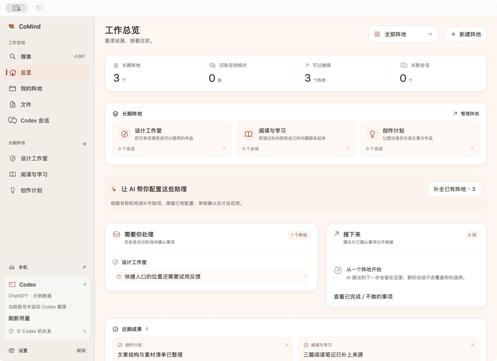

[简体中文](README.md) | English

# CoMind Cockpit

  

**A native Mac workspace connecting long-running topics, Codex conversations, and your existing notes.**

Organize work into persistent areas, pick up a conversation, save useful information to its original Markdown note, and read current material in later chats. Notes remain independent files; the cockpit manages references, work in progress, and review.



*Actual native UI with isolated synthetic content, not a real account. A new installation starts empty. The current interface is primarily Chinese.*

## Features

- Persistent areas with goals, editable AI-drafted responsibilities, drag ordering, progress and next actions.
- Local Codex conversations, available model and reasoning selection, Skills, image attachments, queued messages, and turn navigation.
- References to existing Markdown / Obsidian notes, per-area chat permissions, whole-response or selected-text capture into existing originals.
- Evidence-aware organization, review of uncertainty, version checks and history beside the original files.
- Durable chat and editor drafts, actionable save failures, recovery, source search and relocation, conservative attachment cleanup.
- Light and dark themes, font size controls, hover feedback, keyboard navigation and long-chat browsing.

## Install

**v0.2.0 is experimental. Apple Silicon and macOS 14+ are required.**

[Download CoMind-Cockpit-v0.2.0-macos-arm64.zip](https://github.com/prozacLaputa/comind-cockpit/releases/download/v0.2.0/CoMind-Cockpit-v0.2.0-macos-arm64.zip)

Unzip and move `CoMind.app` to Applications. This build is ad-hoc signed and **not Apple-notarized**. macOS may block its first launch; review the source and use the system Privacy & Security approval flow if you choose to proceed.

Chat requires a usable, signed-in local Codex CLI or desktop installation. The notes bridge requires Python 3. Grant file access when macOS requests it. The app uses iCloud Drive for work state; resolve storage warnings before editing.

## Getting started

1. Create an area and describe its purpose. Review any AI-drafted responsibilities.
2. Link a local Codex conversation or start one in the Work tab.
3. Follow [notes setup](docs/notes.md) to bind your existing vault and collaboration workspace, then choose original notes and chat access in the area’s Sources tab.
4. Save excerpts to an existing original, and review uncertain statements before treating them as confirmed information. Try the workflow with disposable notes first.

The app **does not install background schedules**. Scheduled consolidation requires a separately configured executor. This repository contains the manual workflow and generic bridge, not the author's private automations, routing or notes. Do not place your note vault inside this source repository.

## Codex and usage

This is an independent third-party client, not an official OpenAI product. It uses the local `codex app-server` and existing login. Links store conversation IDs rather than forked chat copies. Messages, AI responsibility drafts, progress updates and AI organization consume the connected account's usage. Local search, copying text and changing themes do not themselves call a model.

Model availability and usage windows come from the local service and can change. No API key or quota is bundled. Authorized context sent to AI is processed through the services Codex uses; local files do not make model execution offline. The app-server protocol is evolving; report issues with versions and sanitized reproduction steps.

## Data and recovery

Original notes stay in the existing vault. Collaboration instructions stay in the chosen workspace. References, layout and drafts live under `CoMind 驾驶舱` in iCloud Drive; the system controls sync completion. Original edits retain history and check versions before writes. Conflicting external changes are not silently overwritten. Attachment cleanup only removes known unsent, unreferenced, expired app copies.

See [storage and recovery](docs/storage.md). No real notes, credentials, sessions or iCloud state are included.

## Shortcuts

| Action | Shortcut |
| --- | --- |
| Send / newline | Enter / Shift + Enter |
| New area | ⌘N |
| Capture to original note | ⇧⌘N |
| Open local file | ⌘O |
| Search | ⇧⌘F |
| Settings | ⌘, |
| Close an in-app modal | Esc or click outside |

## Develop

Requires macOS, Xcode Command Line Tools and Python 3. No npm or browser shell is used.

```bash
git clone https://github.com/prozacLaputa/comind-cockpit.git
cd comind-cockpit
bash macos/build.sh
open macos/build/CoMind.app
```

The build script currently targets arm64. The app icon is included; interface symbols use SF Symbols.

```bash
python3 macos/Tests/run-workflow.py
python3 macos/Tests/run-daily.py
python3 -m unittest discover -s tools/scripts/knowledge-bridge -p 'test_*.py'
python3 -m unittest discover -s tools -p 'test_init_workspace.py'
```

Tests use temporary files and a fake app-server, not real notes or models. See [validation scope](docs/testing.md).

[MIT](LICENSE) · [Changelog](CHANGELOG.md) · [More work](https://prozaclaputa.github.io/)
